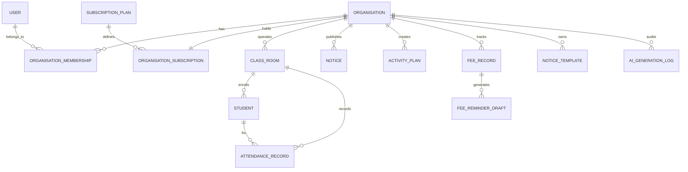

# Previa Architecture Documentation

This document describes the software architecture, data modeling, multi-tenancy enforcement, and security boundaries of **Previa — Preschool AI Assistant**.

---

## 1. Architectural Philosophy & Patterns

Previa is designed as a **Modular Clean Architecture (Layered Hexagonal Architecture)** to ensure high maintainability, independent testability, and strict decoupling of business rules from database technologies and external LLM vendors.

```
┌────────────────────────────────────────────────────────┐
│             Presentation Layer                         │
│  - Previa.Api (ASP.NET Core 10 Web API)                │
│  - Controllers, Swagger, Middlewares, Health Checks     │
└──────────────────────────┬─────────────────────────────┘
                           │
┌──────────────────────────▼─────────────────────────────┐
│             Application Layer                          │
│  - Previa.Application                                  │
│  - Use Cases, Service Interfaces, DTOs, FluentValidation│
│  - Multi-tenant current user abstractions              │
└──────────────────────────┬─────────────────────────────┘
                           │
┌──────────────────────────▼─────────────────────────────┐
│             Domain Layer (Core)                        │
│  - Previa.Domain                                       │
│  - Entities, Domain Enums, ITenantEntity, BaseEntity   │
└──────────────────────────▲─────────────────────────────┘
                           │
┌──────────────────────────┴─────────────────────────────┐
│             Infrastructure Layer                       │
│  - Previa.Infrastructure                               │
│  - EF Core ApplicationDbContext, MySQL / SQLite        │
│  - ConfigurableAiService (OpenAI / Claude / Sandbox)   │
│  - BCrypt PasswordHasher, JwtTokenService              │
└────────────────────────────────────────────────────────┘
```

---

## 2. Multi-Tenancy & Isolation Architecture

In Previa, independent preschools or daycare branches operate as isolated **Organisations (Tenants)**.

### Strict Tenancy Rules:
1. **Never Trust Client-Supplied Tenant Identifiers**: The client application cannot specify an arbitrary `tenantId` in the body or query parameter to access resources.
2. **Identity Derivation from Claims**: Upon login, the user's verified `OrganisationId` and `Role` are embedded inside the cryptographically signed JWT claims (`org_id`, `sub`, `role`).
3. **CurrentUserService**: Injected via dependency injection per request (`ICurrentUserService`), reading tenant context directly from `HttpContext.User`.
4. **Database Scoping**:
   - Every domain entity implementing `ITenantEntity` contains an indexed `OrganisationId` foreign key.
   - All queries filter through `x.OrganisationId == organisationId`.
   - Creation logic automatically assigns `entity.OrganisationId = currentOrganisationId`.

---

## 3. Pluggable AI Provider Architecture

The AI module isolates business logic from third-party LLM vendors via `IAiAssistantService`.

```
                        ┌────────────────────────┐
                        │  IAiAssistantService   │
                        └───────────┬────────────┘
                                    │
                                    ▼
                        ┌────────────────────────┐
                        │ ConfigurableAiService  │
                        └───────┬────────┬───────┘
                                │        │
                Has API Key?    │        │   No API Key?
             ┌──────────────────┘        └─────────────────┐
             ▼                                             ▼
  ┌─────────────────────┐                       ┌─────────────────────┐
  │ Live LLM API Client │                       │ Offline Educational │
  │ OpenAI / Claude /   │                       │ Domain Synthesis    │
  │ Gemini / DeepSeek   │                       │ (Gu/Hi/En Engine)   │
  └─────────────────────┘                       └─────────────────────┘
```

### Safety & Reliability Guarantees:
- **Resilience**: If the external AI provider is unreachable or credentials are not yet provisioned in environment variables, the system seamlessly uses the offline domain synthesis engine without crashing or returning empty responses.
- **Quota Protection**: Every AI invocation checks the tenant's current monthly subscription quota via `ISubscriptionService.CanPerformAiActionAsync`.
- **Audit Logging**: Every AI request is recorded in `AiGenerationLogs` with execution duration, token estimates, model identifier, and success status.

---

## 4. Database Schema & Key Entities



### Entity Summary:
- **`Organisation`**: Preschool institution name, city, registration code, active status.
- **`User`**: Account email, hashed password (BCrypt), name, phone, email verification status.
- **`OrganisationMembership`**: Maps users to organisations with roles (`Owner`, `Administrator`, `Teacher`, `ReadOnlyStaff`).
- **`SubscriptionPlan` & `OrganisationSubscription`**: Commercial limits (max students, max classes, monthly AI limits, allowed features).
- **`ClassRoom` & `Student`**: Minimal student records (First name, Last name, Roll number, Guardian name and WhatsApp).
- **`AttendanceRecord`**: Daily roll-call status with composite index and unique constraint on `(ClassRoomId, StudentId, Date)` to prevent accidental duplicate entries.
- **`Notice`**: School announcements, notice category, target audience, WhatsApp format, and regional language.
- **`ActivityPlan`**: Multi-day early childhood lesson plan with daily themes, objectives, materials, duration, and safety considerations.
- **`FeeRecord` & `FeeReminderDraft`**: Manual fee ledger tracking and drafted parent reminders.
- **`NoticeTemplate`**: Pre-seeded system templates and custom organisation templates.
- **`AuditEvent`**: Tracks important administrative operations for accountability.
